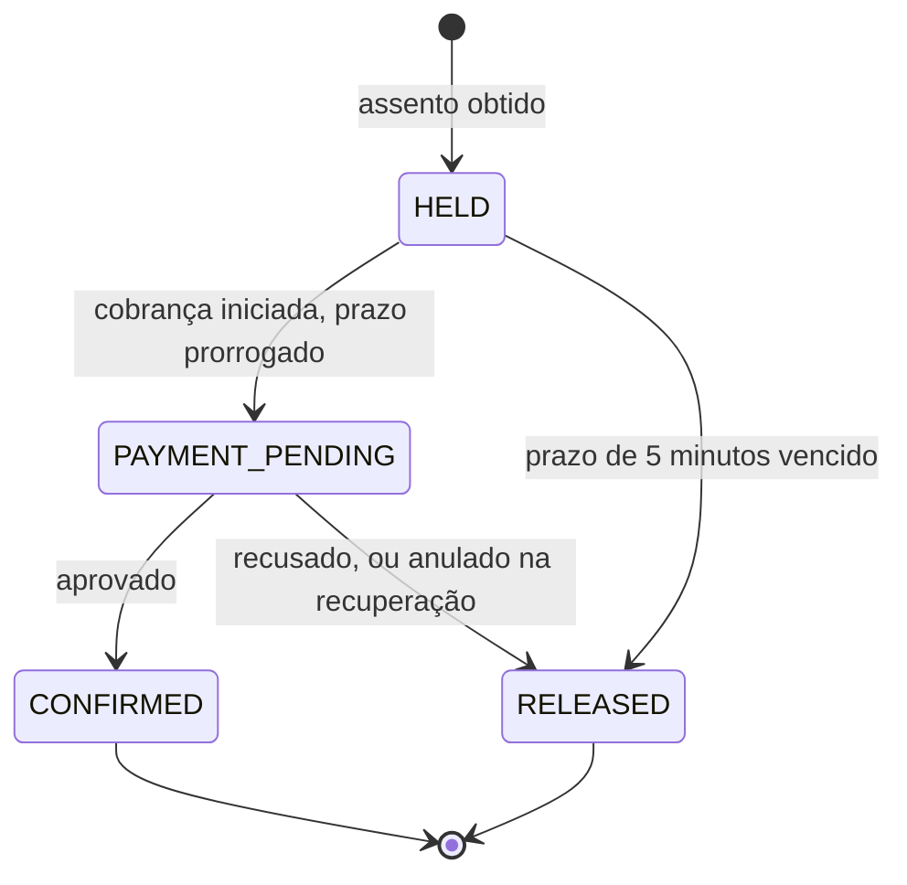

# ADR-002: SAGA orquestrada com estado persistido

**Status:** aceito · **Data:** 05/11/2026

## Contexto

A compra atravessa serviços com bancos separados, então não há transação única. É preciso coordenar reserva, cobrança e confirmação e compensar falhas, inclusive em três casos difíceis: pagamento que termina depois do prazo, timeout com resultado desconhecido e queda do próprio orquestrador.

## Decisão

Usar uma **SAGA orquestrada pelo serviço de Reservas**, com o estado persistido na mesma transação das mudanças de assento.

Regras:

- **Prazo:** ao entrar em `PAYMENT_PENDING`, o prazo é prorrogado (valor inicial: 60 s). A varredura não libera o assento durante a cobrança.
- **Idempotência:** o `reservation_id` é a chave de idempotência da cobrança.
- **Timeout:** não significa falha. A reserva continua em `PAYMENT_PENDING`, e a recuperação consulta o resultado.
- **Compensação:** para desistir de uma cobrança, a recuperação chama `POST /payments/{reservation_id}/void`. A operação é idempotente: cancela ou estorna a cobrança e rejeita uma tentativa que chegue depois. Só então o assento é liberado.
- **Recuperação:** uma varredura retoma reservas com o prazo vencido, inclusive depois de uma queda. Ela usa `FOR UPDATE SKIP LOCKED`, o que permite várias réplicas.

## Alternativas consideradas

| Alternativa | Por que não foi escolhida |
|---|---|
| SAGA coreografada | O fluxo fica espalhado entre consumidores, e fica mais difícil raciocinar sobre o prazo e a recuperação |
| Transação distribuída (2PC) | Bloqueia recursos durante a chamada externa, e provedores de pagamento não participam dela |
| Orquestrador dedicado (Temporal, Camunda) | Infraestrutura desproporcional para um único fluxo |

## Consequências

- **Positivas:** o fluxo inteiro está em um só lugar, e uma queda não perde a compra em andamento.
- **Negativas:** o serviço de Reservas concentra mais responsabilidade e acopla-se ao contrato de Pagamento. A SAGA tem apenas um participante remoto, e por isso a recuperação e a anulação são a parte mais importante dela.

## Validação

Critérios 3 e 4 do [plano de testes](../test-plan.md), incluindo `docker kill` do orquestrador no meio da cobrança.
