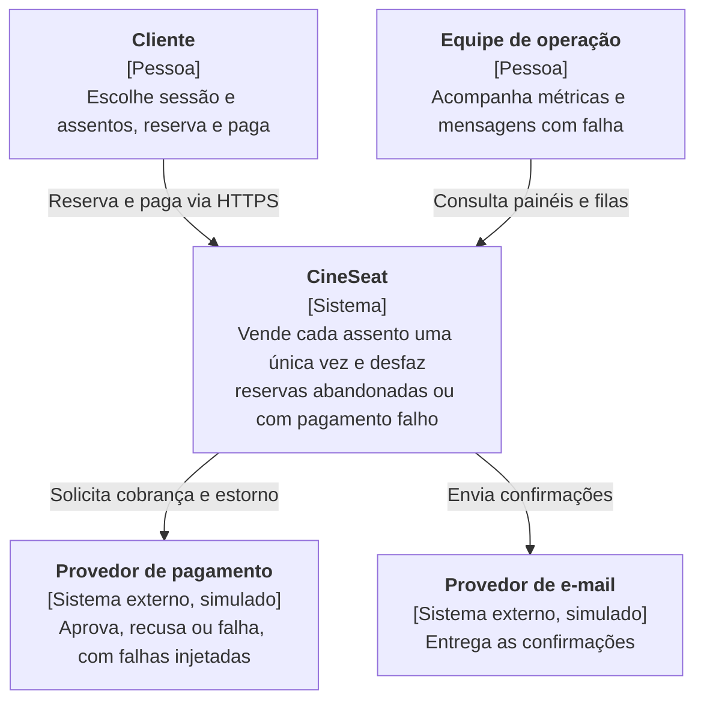
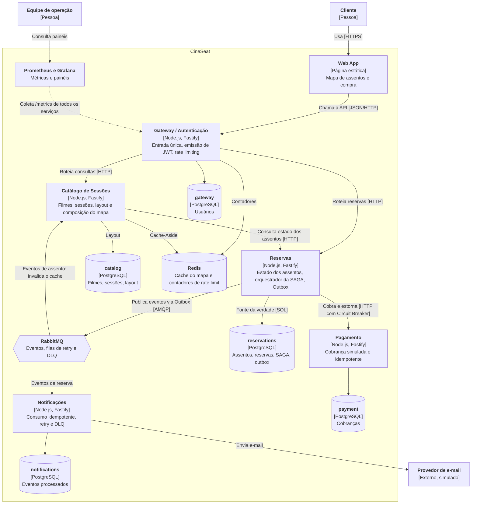

# Diagramas C4

Os diagramas descrevem a arquitetura-alvo. Nesta entrega, os serviços existem como esqueletos executáveis; as interações abaixo serão implementadas no Projeto 03.

## Nível 1: Contexto

> O provedor de pagamento é simulado pelo serviço **Pagamento**, que aparece como container no nível 2 porque faz parte do repositório.

## Nível 2: Containers

## Decisões que os diagramas assumem

- **Escrita com consistência forte:** só o serviço de Reservas altera o estado de um assento ([ADR-001](../adr/ADR-001-seat-source-of-truth.md)).
- **Leitura com consistência eventual:** o mapa pode ficar brevemente desatualizado. Se o assento já tiver sido reservado, a tentativa recebe 409.
- **Pagamento síncrono e eventos assíncronos:** ver [ADR-003](../adr/ADR-003-sync-payment-async-events.md).
